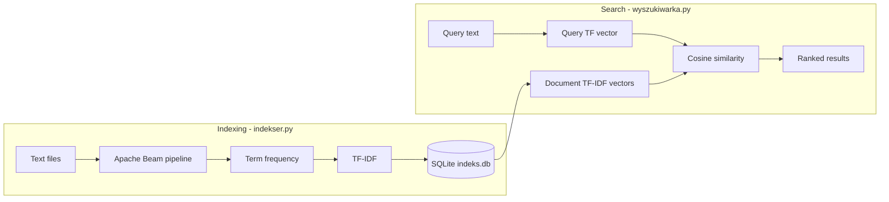

# Full-text search engine for documents in the local file system

A small Python project that indexes plain-text documents from a local folder and ranks them by relevance to a search query. Indexing uses **Apache Beam** for parallel file processing; **TF-IDF** vectors are stored in **SQLite**; search uses **cosine similarity** between the query and each document.

Sample documents and UI strings are in Polish; the same pipeline works for any UTF-8 `.txt` files.

## Features

- Batch indexing of `*.txt` files from a configurable directory
- Tokenization with punctuation stripping, lowercasing, and a basic Polish stopword list
- Per-document TF-IDF weights persisted in `indeks.db`
- Top-N search results ranked by cosine similarity
- Unit tests for the TF/TF-IDF pipeline (`pytest` + Beam `TestPipeline`) and the search helpers

## How it works



1. **Indexer** (`app/indekser.py`): matches text files, reads UTF-8 content, computes TF per document, aggregates document frequency (DF) across the corpus, computes TF-IDF, and writes rows to the `dokumenty` table.
2. **Search** (`app/wyszukiwarka.py`): turns the query into a TF vector (same normalization as indexing), loads all document vectors from the database, and returns the best matches by cosine similarity.
3. **Inspect index** (`app/check_db.py`): prints stored TF-IDF weights for each indexed document.

## Requirements

- Python 3.8+
- [Apache Beam](https://beam.apache.org/) (Python SDK)
- [pytest](https://pytest.org/) (for tests)

## Installation

```bash
python -m venv .venv
.venv\Scripts\activate          # Windows
# source .venv/bin/activate     # Linux / macOS

pip install apache-beam pytest
```

## Project layout

```
.
├── app/
│   ├── indekser.py      # Beam pipeline: build the index
│   ├── wyszukiwarka.py  # Search by cosine similarity
│   └── check_db.py      # Dump index contents
├── docs/                # Sample .txt documents (index these)
├── tests/
│   ├── test_indekser.py
│   └── test_wyszukiwarka.py
└── indeks.db            # Created after indexing (gitignored if present locally)
```

Scripts use paths relative to the **`app`** working directory: the database file is `../indeks.db` (repository root). The indexer’s file pattern is `docs\*.txt` relative to the current working directory.

**Tip:** Sample files live in `docs/` at the repository root. Run indexing from the repo root so that pattern matches, or change the `MatchFiles` pattern in `indekser.py` to `../docs/*.txt` when running from `app/`.

## Usage

### 1. Add documents

Place UTF-8 `.txt` files in `docs/` (or update the glob in `indekser.py` to your folder).

### 2. Build the index

From the repository root (so `docs/*.txt` is found):

```bash
python app/indekser.py
```

If you run from `app/` instead, adjust the file glob as noted above. The pipeline recreates the `dokumenty` table and writes `indeks.db` at the repository root when paths align with `../indeks.db`.

### 3. Search

Edit the query in `app/wyszukiwarka.py` or import `search` from your own script:

```python
from app.wyszukiwarka import search

search("Python jest tak szybki", "../indeks.db", top_n=3)
```

Run from `app/`:

```bash
cd app
python wyszukiwarka.py
```

### 4. Inspect the database

```bash
cd app
python check_db.py
```

## Running tests

From the repository root:

```bash
pytest tests/ -v
```

Beam tests use `TestPipeline`; TF-IDF save tests write through the real SQLite path configured in `TFIDF_I_Save` (see `tests/test_indekser.py`).

## Configuration

| Item | Location | Default |
|------|----------|---------|
| Stopwords | `STOPWORDS` in `indekser.py` / `wyszukiwarka.py` | `jest`, `i`, `w`, `na`, `z`, `a` |
| Indexed file pattern | `indekser.py` → `MatchFiles` | `docs\*.txt` |
| Database path | `../indeks.db` from `app/` | SQLite file at repo root |
| Top results | `search(..., top_n=3)` | 3 |

## License

No license file is included in this repository; add one if you plan to distribute the project.
